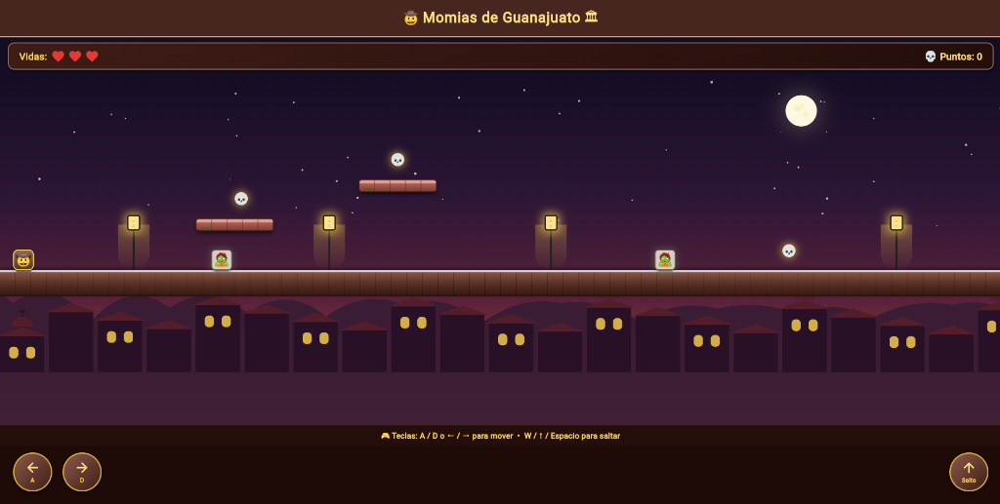

# 🤠 Momias de Guanajuato: La Leyenda 🏛️

Un juego de plataformas en 2D con física real, construido **100% con Test-Driven Development (TDD)** en Flutter / Dart.



---

## 📖 Descripción del Proyecto

Un explorador debe cruzar los callejones de Guanajuato saltando entre plataformas de cantera rosa, esquivando o derrotando momias que patrullan los callejones, recolectando calaveritas de azúcar, hasta llegar al legendario **Callejón del Beso**.

Toda la física, colisiones y reglas del juego se construyeron primero como funciones y clases puras en Dart con pruebas unitarias antes de tocar la interfaz de Flutter.

---

## 🎮 Mecánicas del Juego

- **Gravedad y Salto**: El personaje cae por gravedad realista y aterriza suavemente sobre las plataformas.
- **Movimiento fluido**: Soporte tanto para botones táctiles en pantalla como controles físicos por teclado.
- **Patrullaje de Momias**: Enemigos con IA de patrullaje determinista entre límites que cambian de sentido al chocar con sus bordes.
- **Combate Stomp**: Saltar encima de la mitad superior de una momia la derrota y genera un rebote; chocar lateralmente le quita una vida al personaje.
- **Calaveritas de azúcar**: Coleccionar calaveritas otorga 50 puntos cada una.
- **Meta (El Callejón del Beso)**: Llegar a la meta en la posición final gana la partida. Quedarse sin vidas causa Game Over.

---

## 🕹️ Controles

| Acción | Teclado | Controles en pantalla |
| :--- | :--- | :--- |
| **Mover a la izquierda** | `A` o Flecha Izquierda `←` | Botón `A` / `←` |
| **Mover a la derecha** | `D` o Flecha Derecha `→` | Botón `D` / `→` |
| **Saltar** | `W`, Flecha Arriba `↑` o `Espacio` | Botón `Salto` / `↑` |

---

## 🏗️ Arquitectura y Estructura del Código

```text
lib/
  logica/
    rectangulo.dart         # Algoritmo de colisión AABB
    personaje.dart          # Estado y dimensiones del jugador
    momia.dart              # IA de patrullaje determinista
    calaverita.dart         # Bounding box e ítems coleccionables
    motor_fisica.dart       # Gravedad, salto, colisión de piso y meta
    motor_combate.dart      # Detección de stomp vs golpe al jugador
    estado_juego.dart       # Estados: jugando, ganado, perdido
    motor_juego.dart        # Orquesta el bucle de juego y reglas
  presentation/
    widgets/
      fondo_guanajuato.dart   # Fondo con Parallax, atardecer y cerros
      plataforma_cantera.dart # Bloques de cantera rosa y adoquín
      callejon_beso_widget.dart # Balcones y meta escenográfica
      sprites_rusticos.dart   # Sprites estilizados y faroles coloniales
    juego_screen.dart       # Cámara, controles y HUD
  main.dart                 # Punto de entrada de la aplicación
test/
  rectangulo_test.dart      # Ronda 1: Colisión AABB
  motor_fisica_test.dart    # Rondas 2, 3, 4 y 8: Física, salto y límites
  momia_test.dart           # Ronda 5: Patrullaje de momias
  motor_combate_test.dart   # Ronda 6: Combate stomp vs daño
  motor_juego_test.dart     # Rondas 7, 9, 10 e Integración
```

---

## 🧪 Pruebas Unitarias y TDD (23 / 23 Pasadas)

Para ejecutar la suite completa de pruebas:

```bash
flutter test
```

Salida:
```text
00:02 +23: All tests passed!
```

---

## 🚀 Cómo ejecutar la aplicación

1. Clonar el repositorio:
   ```bash
   git clone https://github.com/GerardoMV28/Momias-gto.git
   cd Momias-gto
   ```

2. Instalar dependencias:
   ```bash
   flutter pub get
   ```

3. Ejecutar el proyecto:
   ```bash
   flutter run
   ```
